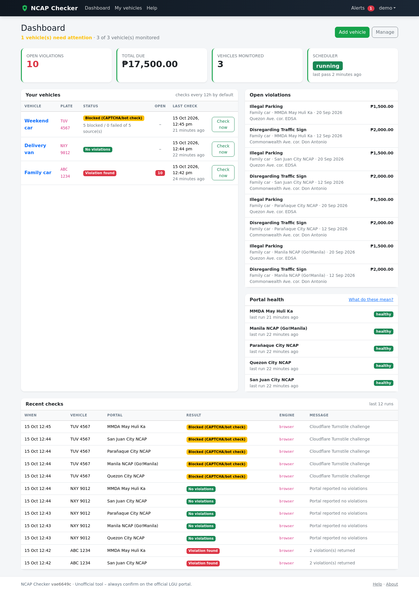
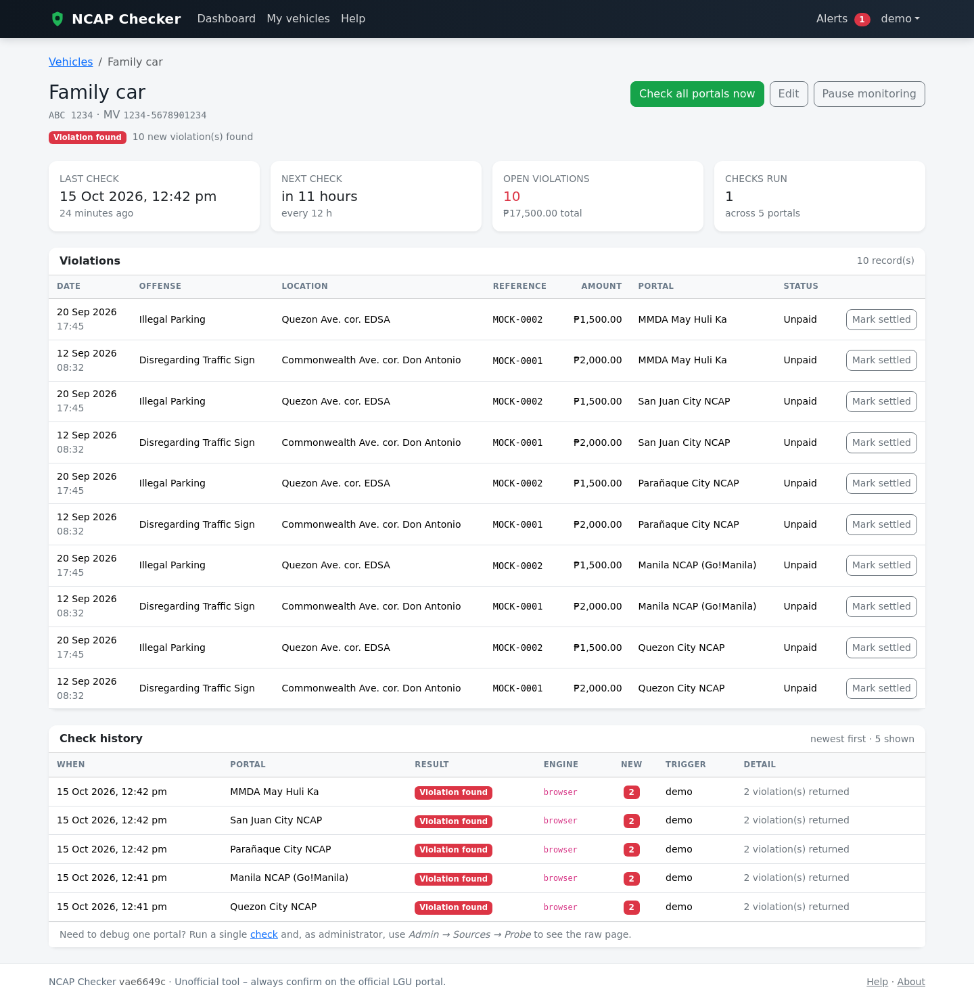
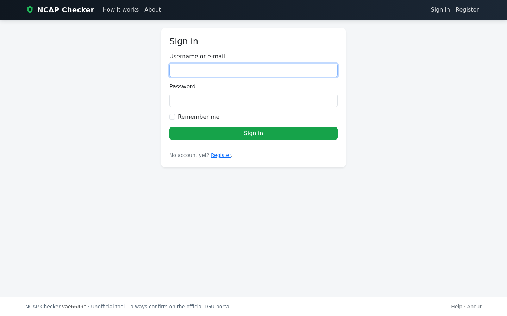
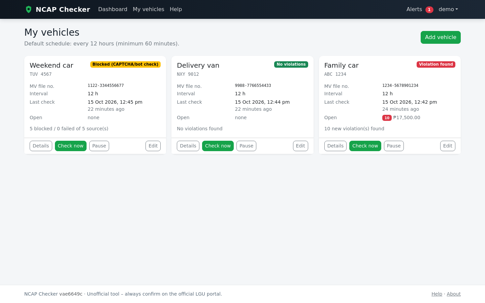
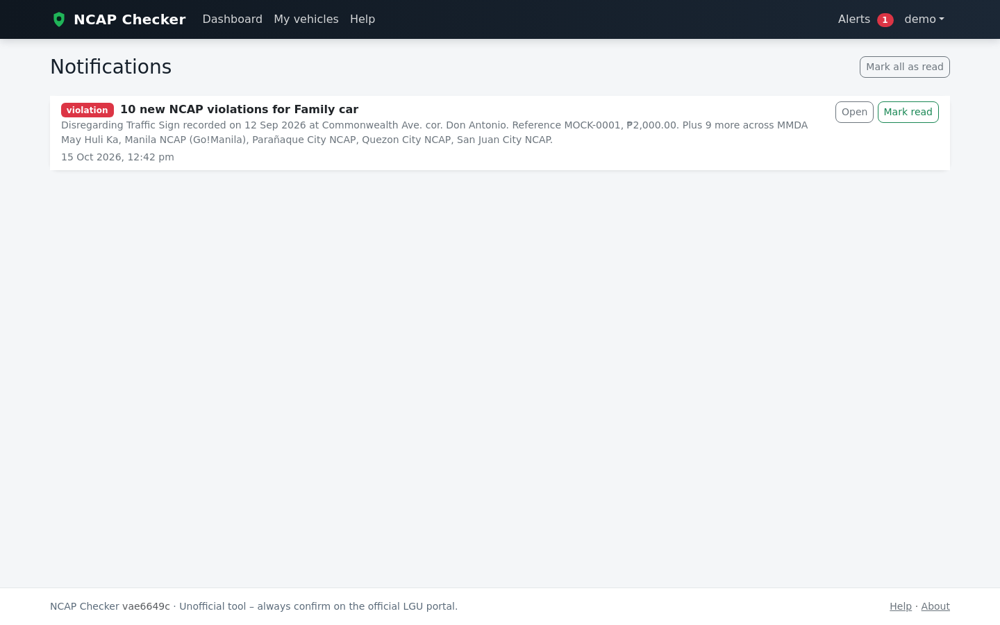
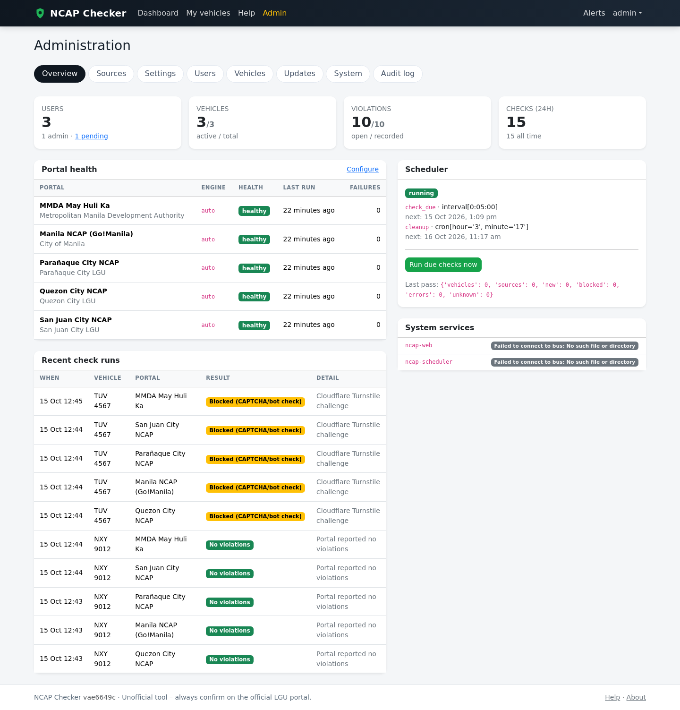
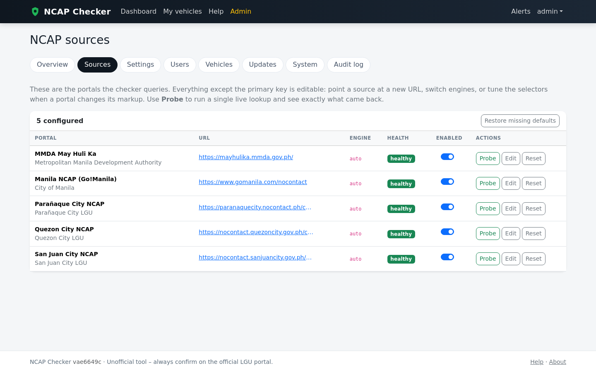
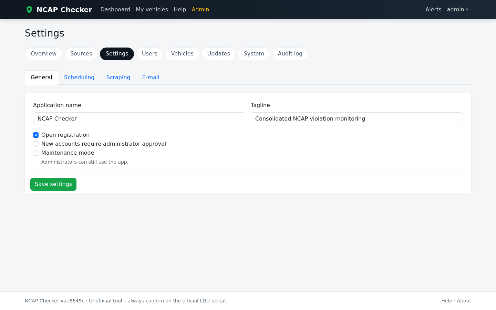
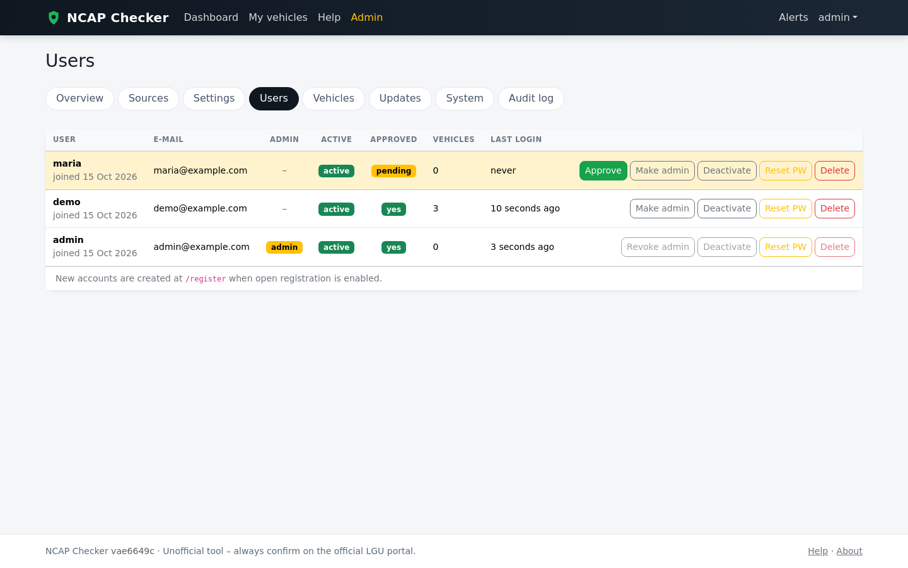
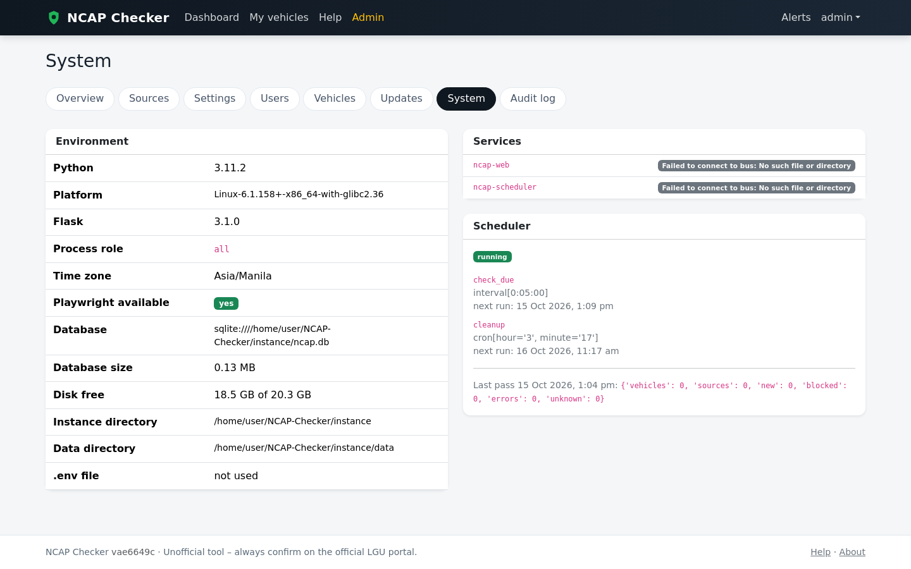

# NCAP Checker

One dashboard for **Metro Manila NCAP violations**. Save a plate number and its
MV file number once and NCAP Checker queries all five official portals on a
schedule, de-duplicates what it finds, and tells you when something new appears.

> **Unofficial tool.** NCAP Checker is not affiliated with any LGU or with the
> MMDA. It only reads information you could look up yourself. Always confirm on
> the official portal before paying anything.

---

## Screenshots

| | |
| :-- | :-- |
| **Dashboard** — every vehicle and its worst status at a glance<br> | **Vehicle detail** — per-portal results, violations and run history<br> |
| **Sign in**<br> | **My vehicles**<br> |
| **Notifications**<br> | **Admin → Overview**<br> |
| **Admin → Sources** — health, circuit breaker and probing<br> | **Admin → Settings**<br> |
| **Admin → Users** — approvals, roles, password resets<br> | **Admin → System** — versions, paths, service status<br> |

*The screenshots show seeded demo data: the vehicle data is fictitious.*

---

## What it does

**One consolidated result per vehicle.** A plate + MV file number is looked up
on all five portals, and the results are merged into a single list. The same
ticket reported by two cities is stored once, not twice.

**Portals covered**

| Portal | Agency | Lookup needs | Notes |
| :-- | :-- | :-- | :-- |
| [nocontact.quezoncity.gov.ph](https://nocontact.quezoncity.gov.ph/check-violations) | Quezon City LGU | Plate + MV file no. | Turnstile-protected SPA |
| [gomanila.com/nocontact](https://www.gomanila.com/nocontact) | City of Manila | Plate number (+ lookup type) | reCAPTCHA |
| [paranaquecity.nocontact.ph](https://paranaquecity.nocontact.ph/check-violations) | Parañaque City LGU | Plate + MV file no. | Turnstile-protected SPA |
| [nocontact.sanjuancity.gov.ph](https://nocontact.sanjuancity.gov.ph/check-violations) | San Juan City LGU | Plate + MV file no. | Turnstile-protected SPA |
| [mayhulika.mmda.gov.ph](https://mayhulika.mmda.gov.ph/) | MMDA (May Huli Ka) | Plate + MV file no. | Blocks many datacentre IPs |

**Accounts**

* Self-service registration, optional admin approval for new accounts.
* One-time administrator bootstrap: the first visit to `/setup` (or
  `flask create-admin`) promotes an owner — after that the button is gone.
* Per-user API keys, password changes, and profile management.

**Scheduled checking**

* Each vehicle gets its own interval (default 12 hours; 1 hour minimum).
* A background scheduler process ticks every 5 minutes and picks up due vehicles,
  so a restart never loses a check.
* "Check now" runs in a worker thread with live progress — the page tells you
  it started and refreshes itself when the results land. No more frozen tabs.

**Notifications**

* Always-on in-app notifications (bell icon + unread badge).
* Optional e-mail alerts over SMTP (STARTTLS or implicit SSL). Off until you
  configure it, and there is a **Send test e-mail** button to prove it works.
* Alerts can be triggered by new violations, resolved violations, or portal
  failures — your choice.

**Operations**

* **Admin → Sources**: enable/disable a portal, change its URL, set the engine
  and delay, probe it against a real plate, or reset its circuit breaker.
* **Per-source circuit breaker**: after a failure a portal backs off (5 → 20 →
  40 … → 240 minutes) instead of hammering it.
* **Admin → Updates**: one-click `git pull` + `pip install` + service restart
  from the browser, or disable self-update entirely with `NCAP_UPDATE_MODE=disabled`.
* **Maintenance mode**, audit log, configurable retention for check history.
* **REST API** for scripting: `/api/status`, `/api/vehicles`, `/api/violations`,
  `/api/vehicles/<id>/check`, `/api/lookup`.

---

## How a check works

1. **HTTP first.** A plain `requests` + BeautifulSoup pass is fast and cheap.
2. **Browser fallback.** If the portal answers with a CAPTCHA wall, an empty
   shell, or a JavaScript-only page, the same lookup is retried in headless
   Chromium (Playwright), which keeps cookies per portal and can save a
   screenshot of what it saw.
3. **Never guess.** A portal that cannot be positively read is reported as
   `blocked`, `unknown` or `error` — *not* as "no violations". The dashboard
   would rather admit it does not know than tell you that you are clean.
4. **Fingerprint and de-duplicate.** Each finding is hashed (agency + ticket +
   date + location + amount), so re-checking refreshes timestamps instead of
   creating duplicates, and the same ticket from two cities collapses into one
   row with per-source detail behind it.

---

## Install on Ubuntu (recommended)

Requires Ubuntu 20.04 / 22.04 / 24.04 (or another Debian derivative), root
access, and outbound HTTPS. About 5–10 minutes, mostly Chromium.

```bash
git clone https://github.com/mikeehendricks/NCAP-Checker.git
cd NCAP-Checker
sudo ./install.sh
```

The installer:

1. installs system packages (Python, build tools, nginx, Chromium libraries);
2. creates the `ncap` system account and installs to `/opt/ncap-checker`;
3. creates a virtualenv and installs the pinned requirements;
4. generates `.env` (random secret key, timezone `Asia/Manila`) with mode `600`;
5. creates the database, default settings and the five portals;
6. downloads Chromium for Playwright;
7. installs and starts `ncap-web` (gunicorn) and `ncap-scheduler` (systemd);
8. installs the nginx site and a narrow sudoers rule so the Update button can
   restart the two services;
9. creates the administrator (prompted, or skipped if one already exists).

Then open **<http://your-server-ip/>**.

### Installer options

| Flag | Purpose |
| :-- | :-- |
| `--dir PATH` | Install somewhere else (default `/opt/ncap-checker`) |
| `--repo URL` | Clone a fork instead of the upstream repository |
| `--branch NAME` | Track a different branch (default `main`) |
| `--user NAME` | Service account (default `ncap`) |
| `--port PORT` | Gunicorn port (default `8000`) |
| `--domain NAME` | `server_name` for nginx, e.g. `ncap.example.com` |
| `--local` | Install from the current directory instead of git |
| `--no-browser` | Skip Chromium (HTTP engine only) |
| `--no-nginx` | Do not touch nginx (bring your own reverse proxy) |

Unattended installs:

```bash
sudo env NCAP_ADMIN_USER=admin NCAP_ADMIN_EMAIL=me@example.com \
     NCAP_ADMIN_PASSWORD='a-long-password' ./install.sh
```

Re-running `install.sh` is safe: it refreshes code, dependencies and unit files
and **never overwrites** your `.env`, database or screenshots.

### After installing

```
sudo systemctl status ncap-web ncap-scheduler
sudo journalctl -u ncap-web -f
tail -f /var/log/ncap-checker/ncap.log
```

**HTTPS** (strongly recommended — the site handles credentials):

```bash
sudo certbot --nginx -d ncap.example.com
sudo sed -i 's/^NCAP_SESSION_SECURE=.*/NCAP_SESSION_SECURE=true/' /opt/ncap-checker/.env
sudo systemctl restart ncap-web ncap-scheduler
```

Removing it again:

```bash
sudo ./uninstall.sh            # keeps /opt/ncap-checker/instance and .env
sudo ./uninstall.sh --purge    # deletes everything, including the ncap user
```

---

## Manual install (any Linux/macOS with Python 3.10+)

```bash
python3 -m venv .venv && source .venv/bin/activate
pip install -r requirements.txt
pip install playwright && playwright install chromium     # optional but advised
cp .env.example .env            # then edit NCAP_SECRET_KEY
export NCAP_ENV=development NCAP_ROLE=all
flask --app wsgi init-db
flask --app wsgi create-admin admin you@example.com
python run.py                   # http://127.0.0.1:5000
```

For production, run both roles as separate processes (as the systemd units do):

```bash
NCAP_ROLE=web       gunicorn --bind 127.0.0.1:8000 --workers 2 --threads 4 wsgi:app
NCAP_ROLE=scheduler python scheduler_worker.py
```

---

## Configuration

Settings live in the database and are editable under **Admin → Settings**.
Environment variables (`.env`) seed them and override the rest.

| Variable | Default | Meaning |
| :-- | :-- | :-- |
| `NCAP_ENV` | `production` | `production` / `development` / `testing` |
| `NCAP_SECRET_KEY` | *random per install* | Session + CSRF signing key |
| `NCAP_ROLE` | `all` | `web`, `scheduler`, or `all` (single process) |
| `NCAP_DATABASE_URI` | `sqlite:///instance/ncap.db` | Any SQLAlchemy URL |
| `NCAP_TIMEZONE` | `Asia/Manila` | Displayed times |
| `NCAP_SESSION_SECURE` | `false` | Set to `true` once HTTPS is live |
| `NCAP_SESSION_HOURS` | `12` | Session lifetime |
| `NCAP_ENABLE_SCHEDULER` | `true` | Run the scheduler in-process (used by `NCAP_ROLE`) |
| `NCAP_SCHEDULER_TICK_SECONDS` | `300` | How often due vehicles are looked for |
| `NCAP_PLAYWRIGHT_ENABLED` | `true` | Allow the browser engine |
| `NCAP_PLAYWRIGHT_HEADLESS` | `true` | Headless Chromium |
| `NCAP_PLAYWRIGHT_EXECUTABLE` | *(auto)* | Path to a Chromium binary if not the bundled one |
| `NCAP_HTTP_TIMEOUT` | `30` | Seconds per HTTP request |
| `NCAP_UPDATE_MODE` | `git` | `git` / `manual` / `disabled` — self-update from the admin panel |
| `NCAP_SERVICE_WEB` | `ncap-web` | Service restarted after an update |
| `NCAP_SERVICE_SCHEDULER` | `ncap-scheduler` | ″ |
| `NCAP_MAINTENANCE_MODE` | `false` | Show a maintenance page to non-admins |

Editable in the admin panel: app name/tagline, registration policy, check
interval and minimum interval, request delay, circuit-breaker back-off,
retention, browser options, proxy, SMTP settings, and which events notify.

---

## REST API

Authenticate with the API key from **Profile** in the `X-API-Key` header
(`?api_key=` also works).

| Endpoint | Description |
| :-- | :-- |
| `GET /api/status` | Version, your vehicles, and per-portal health |
| `GET /api/vehicles` | Your vehicles with status and totals |
| `GET /api/violations` | Your 200 most recent violations |
| `POST /api/vehicles/<id>/check` | Queue a check for one vehicle |
| `POST /api/lookup` | One-off lookup, nothing saved — `{"plate_number": "...", "mv_number": "..."}` |

```bash
curl -H "X-API-Key: $KEY" http://localhost:8000/api/status
```

---

## Command line

```bash
flask --app wsgi init-db                    # create tables, defaults, portals
flask --app wsgi seed-sources               # (re)add the five built-in portals
flask --app wsgi create-admin USER EMAIL    # create or promote an administrator
flask --app wsgi check-all                  # run a full check pass now
flask --app wsgi check-vehicle ABC1234      # check one plate
```

---

## Tests

```bash
python -m venv .venv && source .venv/bin/activate
pip install -r requirements-dev.txt
python -m pytest                                   # 194 tests
python -m pytest --cov=app --cov-report=term-missing
```

Nine of those drive real headless Chromium against local mock portals and skip
themselves when Playwright or Chromium is missing, so the other 185 always run.
To enable them:

```bash
pip install playwright && playwright install chromium
```

The suite covers the models, parsing, scrapers, checker, scheduler, notifier,
updater, authentication, admin, vehicles, API and smoke flows, plus an
integration test that drives the five portal scrapers against a local mock
server in real headless Chromium (`scripts/mock_portals.py`). Portal HTML is
never fetched from the live sites in tests.

---

## Troubleshooting

| Symptom | What to check |
| :-- | :-- |
| Every portal shows **blocked** | The portals sit behind Cloudflare Turnstile/reCAPTCHA. Click **Probe** on the source to see what the browser saw; as an admin, the run history links to the screenshot captured during the attempt. Usually resolves itself — or use a residential IP / `proxy_url`. |
| MMDA always fails, others work | `mayhulika.mmda.gov.ph` refuses many datacentre and VPN addresses (HTTP 403). Host at home or via a residential connection, or set a `proxy_url`. |
| Login accepts the password then bounces back | With `NCAP_SESSION_SECURE=true` over plain HTTP the browser drops the cookie. Set it to `false`, or serve HTTPS. |
| "This installation is not a git clone" | Installed with `--local` or from a tarball. Use `git clone` on the server if you want the one-click updater. |
| Update button does nothing | The `ncap` user needs `/etc/sudoers.d/ncap-checker` (the installer writes it) and the units must be named `ncap-web` / `ncap-scheduler`. |
| Checks take a long time | Five portals × browser startup. Raise `request_delay_seconds` only if you need to be gentler; lower it to be faster. Manual checks are asynchronous, so the page stays responsive. |

---

## Responsible use

NCAP Checker polls public portals the way a person would, at a human pace, and
backs off when a portal fails. It stores only the plate and MV numbers you give
it. Please do not point it at other sites or hammer the portals — if an LGU
publishes an official API, prefer it.

## Project layout

```
app/
  blueprints/    auth, dashboard, vehicles, notifications, admin, api
  scrapers/      http engine, browser engine, per-portal adapters, parsing
  services/      checker, scheduler, notifier, updater, settings, audit
  models.py      User, Vehicle, Source, Violation, CheckRun, Notification, …
  templates/     Jinja templates (Bootstrap 5, vendored locally)
scripts/         systemd units, nginx site, sudoers rule, mock portals
docs/screenshots README screenshots
install.sh       Ubuntu server installer
uninstall.sh     removal
scheduler_worker.py  entry point for the scheduler service
tests/           pytest suite
```

## License

MIT — see [LICENSE](LICENSE).
